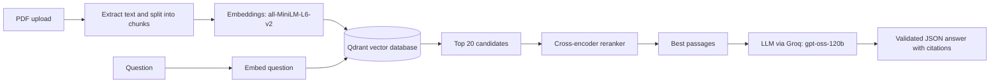

# Document Assistant (RAG)

Upload any PDF and ask questions about it. Each answer shows what the PDF says, a simple explanation, key points to remember, and practice exam questions, with page citations.

## How it works



## Evaluation

Tested on 40 questions generated from random passages of 4 PDFs (insurance policy, annual report, Python textbook, research paper). A question counts as correct when the source page appears in the retrieved results.

| Metric | Vector search only | With reranker |
|---|---|---|
| Correct page in top 1 | 52.5% | 80.0% |
| Correct page in top 5 | 85.0% | 90.0% |
| Correct document at top 1 | 97.5% | 100.0% |

Reproduce with `python eval.py baseline` and `python eval.py reranked`.

## Tech stack

Python, Streamlit, Qdrant, fastembed (ONNX embeddings and reranker), Groq API, Pydantic (answer schema validation), Docker.

## Run locally

```
python -m venv venv
venv\Scripts\activate
pip install -r requirements.txt
```

Create a `.env` file with:

```
QDRANT_URL=your_qdrant_cluster_url
QDRANT_API_KEY=your_qdrant_key
GROQ_API_KEY=your_groq_key
```

Then run `streamlit run app.py`.

## Limits

Scanned (image-only) PDFs are not supported. Uploads are limited to 10 MB and 150 pages.